# Monocular RGB-Based Forklift–Pallet Alignment: Real-World Trial Videos

This repository releases the videos of the real-world experiments in
**"Monocular RGB-Based Forklift–Pallet Alignment via Visibility-Constrained Route Planning and Adaptive Motion Timing"** (manuscript in preparation).

The forklift aligns to the pallet and inserts its forks using only the RGB stream of a single front camera.
No depth data, LiDAR, or sensor measuring the forklift's own position or velocity is used.

- 9 initial pallet configurations (S01–S09) × 3 trials (A, B, C) = 27 trials
- All 27 trials completed alignment and fork insertion
- Watch all videos in the browser: https://anieyo0.github.io/forklift-pallet-alignment/

## Experimental setup

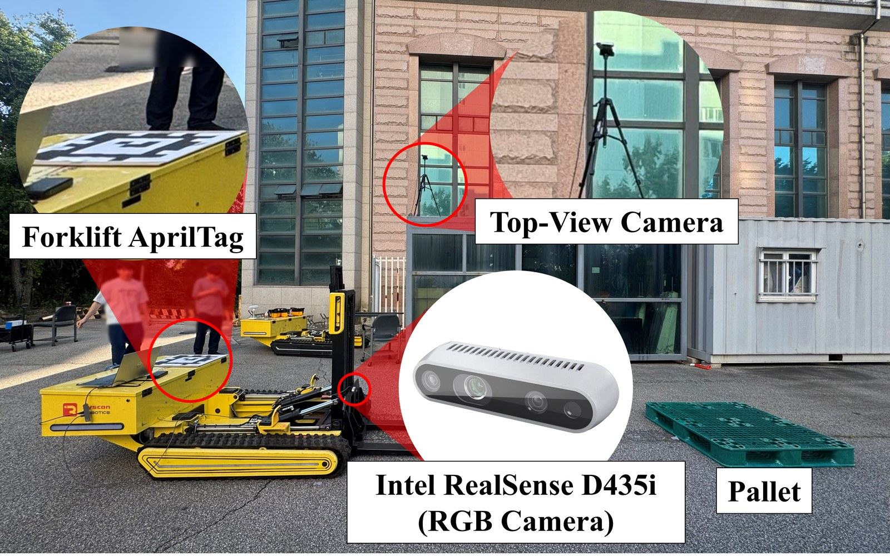

The front Intel RealSense D435i is used as an RGB camera. The overhead top-view camera and the AprilTag on the forklift
are used **only for evaluation**; they are not inputs to the controller.

## Initial configurations and videos

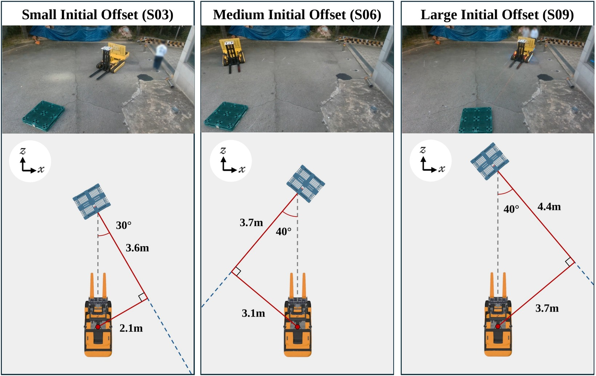

Representative initial configurations of the three groups (S03, S06, S09).
In every scenario the pallet front center is placed on the camera forward axis. d<sub>forward</sub> is the forward distance from the camera to the pallet front, ψ is the pallet yaw, the angle between the fork insertion direction and the camera forward axis (clockwise positive, viewed from above), and δ<sub>0</sub> = d<sub>forward</sub> tan ψ is the lateral offset of the camera from the pallet insertion axis.
Scenarios are grouped into Mild, Moderate and Large by the size of the initial offset.

Thumbnails show the first frame of each video. Click a scenario for its page, or a thumbnail to open the video.

| Group | Scenario | d<sub>forward</sub> (m) | ψ (°) | δ<sub>0</sub> (m) | Trial A | Trial B | Trial C |
|---|---|---|---|---|---|---|---|
| Mild | [**S01**](scenarios/S01) | 3.0 | 0 | 0.0 | [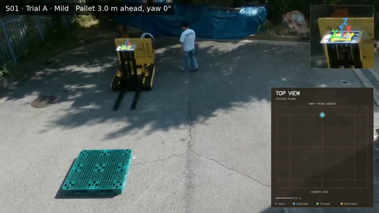](scenarios/S01/S01_A_trajectory.mp4) | [](scenarios/S01/S01_B_trajectory.mp4) | [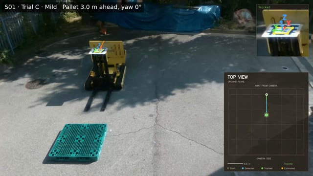](scenarios/S01/S01_C_trajectory.mp4) |
|  | [**S02**](scenarios/S02) | 3.2 | 15 | 0.9 | [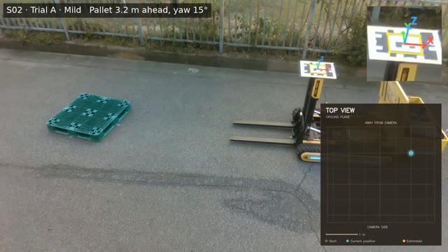](scenarios/S02/S02_A_trajectory.mp4) | [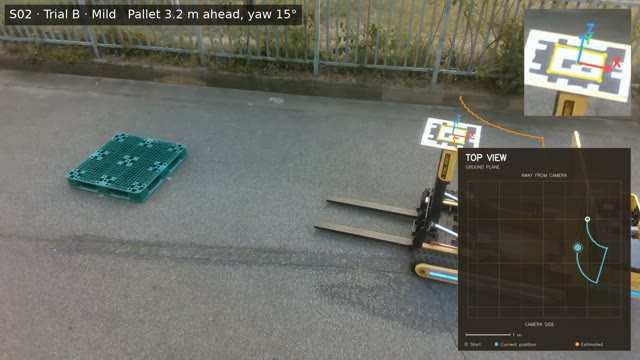](scenarios/S02/S02_B_trajectory.mp4) | [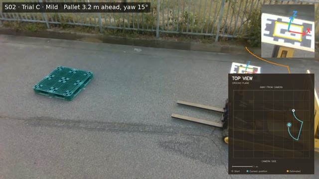](scenarios/S02/S02_C_trajectory.mp4) |
|  | [**S03**](scenarios/S03) | 3.5 | -30 | -2.0 | [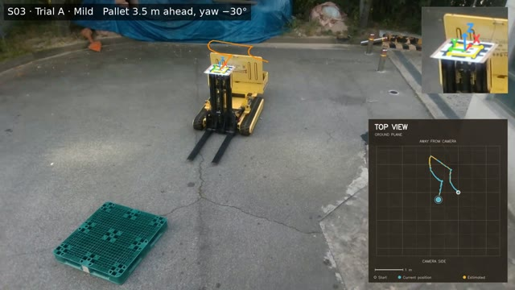](scenarios/S03/S03_A_trajectory.mp4) | [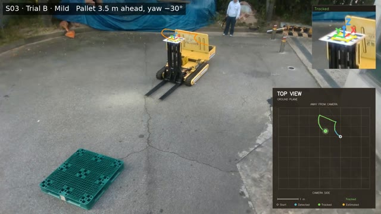](scenarios/S03/S03_B_trajectory.mp4) | [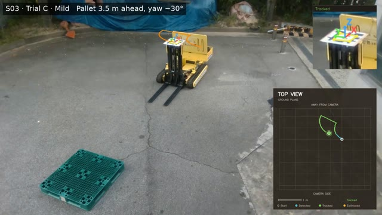](scenarios/S03/S03_C_trajectory.mp4) |
| Moderate | [**S04**](scenarios/S04) | 3.8 | 30 | 2.2 | [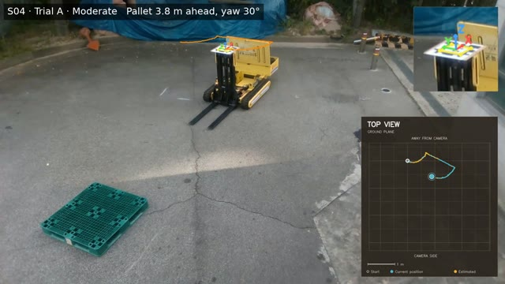](scenarios/S04/S04_A_trajectory.mp4) | [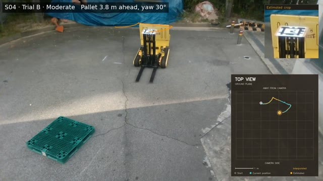](scenarios/S04/S04_B_trajectory.mp4) | [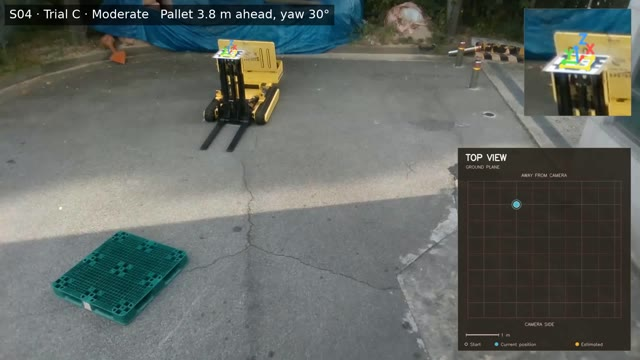](scenarios/S04/S04_C_trajectory.mp4) |
|  | [**S05**](scenarios/S05) | 4.0 | -30 | -2.3 | [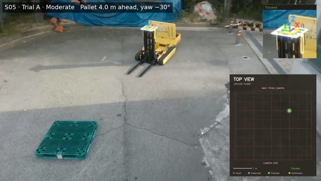](scenarios/S05/S05_A_trajectory.mp4) | [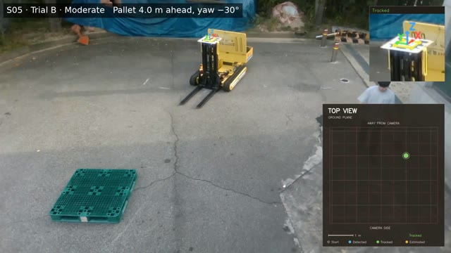](scenarios/S05/S05_B_trajectory.mp4) | [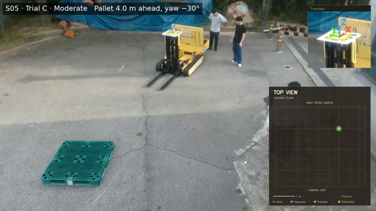](scenarios/S05/S05_C_trajectory.mp4) |
|  | [**S06**](scenarios/S06) | 4.2 | 40 | 3.5 | [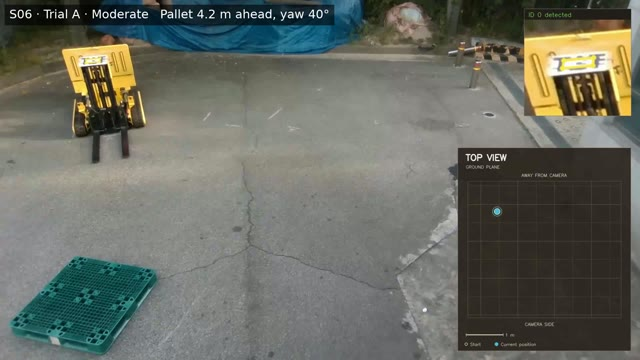](scenarios/S06/S06_A_trajectory.mp4) | [](scenarios/S06/S06_B_trajectory.mp4) | [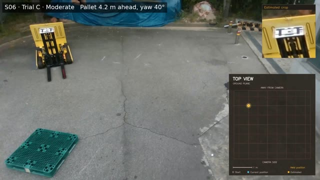](scenarios/S06/S06_C_trajectory.mp4) |
| Large | [**S07**](scenarios/S07) | 4.5 | -40 | -3.8 | [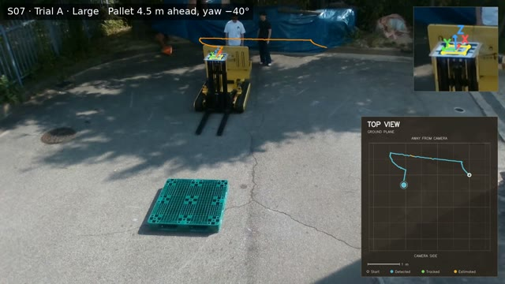](scenarios/S07/S07_A_trajectory.mp4) | [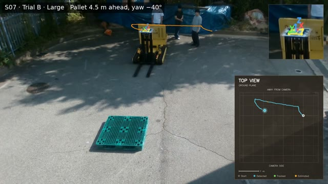](scenarios/S07/S07_B_trajectory.mp4) | [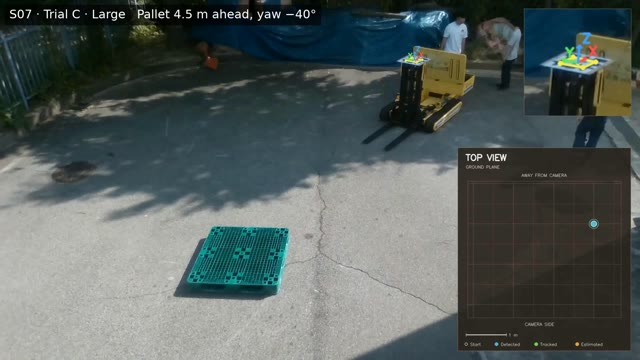](scenarios/S07/S07_C_trajectory.mp4) |
|  | [**S08**](scenarios/S08) | 4.7 | 40 | 3.9 | [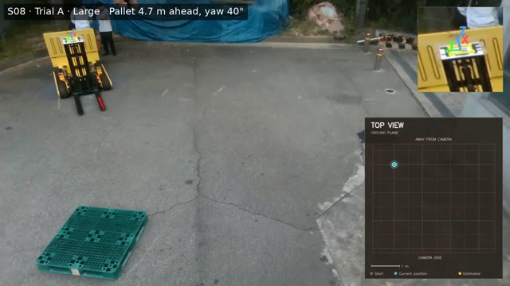](scenarios/S08/S08_A_trajectory.mp4) | [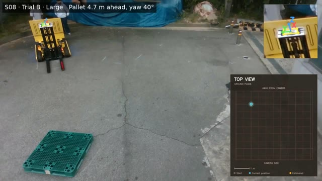](scenarios/S08/S08_B_trajectory.mp4) | [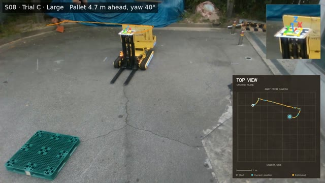](scenarios/S08/S08_C_trajectory.mp4) |
|  | [**S09**](scenarios/S09) | 5.0 | -40 | -4.2 | [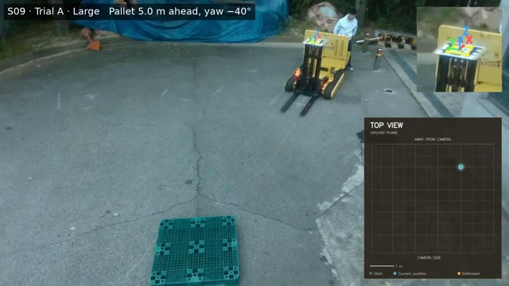](scenarios/S09/S09_A_trajectory.mp4) | [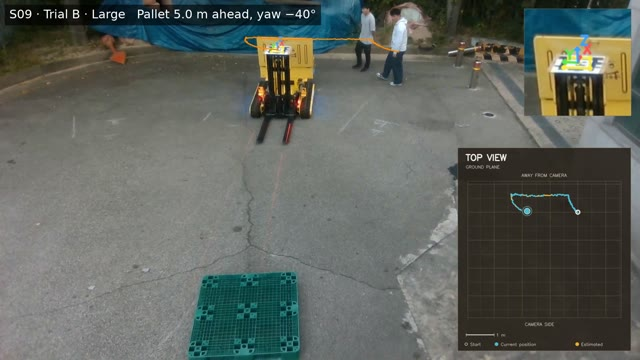](scenarios/S09/S09_B_trajectory.mp4) | [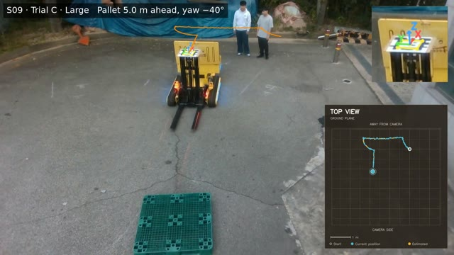](scenarios/S09/S09_C_trajectory.mp4) |

Each video shows the overhead top-view recording with the tracked forklift trajectory and a scenario label.
The original recordings without overlay (`SXX_Y.mp4`) will be archived on Zenodo; the link will be added here.
Audio tracks and file metadata were removed from all videos. People appearing in the videos consented to publication.

## Repository layout

| Path | Content |
|---|---|
| `scenarios/SXX/` | Scenario page (`README.md`), the three trial videos (`SXX_Y_trajectory.mp4`, H.264) and their thumbnails |
| `assets/` | Figures used in this README |
| `index.html` | Video page served by GitHub Pages |
| `LICENSE` | CC BY 4.0 license text |
| `CITATION.cff` | Citation metadata (used by GitHub's "Cite this repository") |

## License

The videos, images and text in this repository are licensed under the
[Creative Commons Attribution 4.0 International License (CC BY 4.0)](LICENSE).
You may share and adapt them for any purpose, provided you give appropriate credit.

## Citation

The paper is in preparation; its citation will be added here after publication.
Until then, please cite this repository:

```bibtex
@misc{kim2026forkliftvideos,
  author       = {Kim, Jihoon and Jang, Doyoung and Kim, Minjae and Lee, Soonkyo and Lee, Sangmin},
  title        = {Monocular {RGB}-Based Forklift--Pallet Alignment: Real-World Trial Videos},
  year         = {2026},
  howpublished = {\url{https://github.com/Anieyo0/forklift-pallet-alignment}}
}
```
