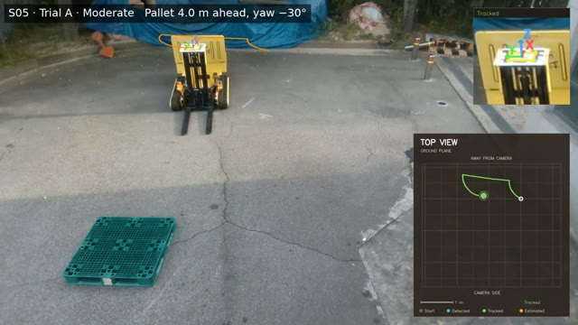
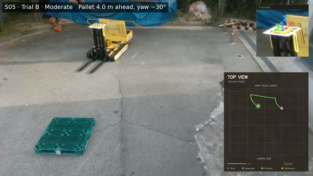
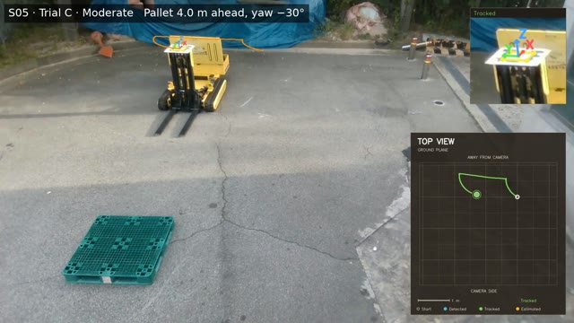

# S05 — Moderate group

[← All scenarios](../../README.md)

## Initial configuration

| Forward distance to pallet | Pallet yaw | Lateral offset |
|---|---|---|
| 4.0 m | -30° | -2.3 m |

The pallet front center is placed on the camera forward axis. The lateral offset is the offset of the camera from the pallet insertion axis (forward distance × tan(yaw)). Yaw is measured clockwise from the camera forward axis.

## Trials

All three trials completed alignment and fork insertion. Click a thumbnail to open the video.

| Trial A | Trial B | Trial C |
|---|---|---|
|  |  |  |

Each video shows the overhead top-view recording with the tracked forklift trajectory. The original recordings without overlay are on Zenodo (see the main README).
