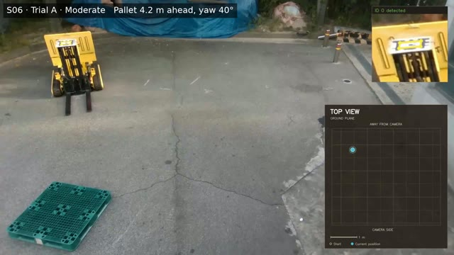
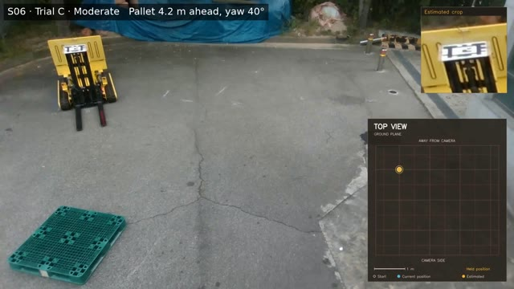

# S06 — Medium initial offset

[← All scenarios](../../README.md)

## Initial configuration

| dforward (m) | dlateral (m) | ψ (°) |
|---|---|---|
| 3.7 | 3.1 | 40 |

The pallet front center is placed straight ahead of the camera. Distances are measured from the forklift's rotation center c, the center of the tracked base, which lies 0.68 m behind the camera. dlateral is the perpendicular distance from c to the pallet insertion axis (the line through the pallet front center along the fork insertion direction); it is positive when c is to the right of the axis, facing the insertion direction. dforward is the distance from c to the pallet front, measured along the insertion axis. ψ is the pallet yaw, the angle between the fork insertion direction and the camera forward axis (clockwise positive, viewed from above). When dlateral = 0 and ψ = 0, the forklift centerline lies on the insertion axis. Distances are rounded to 0.1 m.

## Trials

All three trials completed alignment and fork insertion. Thumbnails show the first frame of each video; click one to open the video.

| Trial A | Trial B | Trial C |
|---|---|---|
|  |  |  |

Each video shows the overhead top-view recording with the tracked forklift trajectory.
