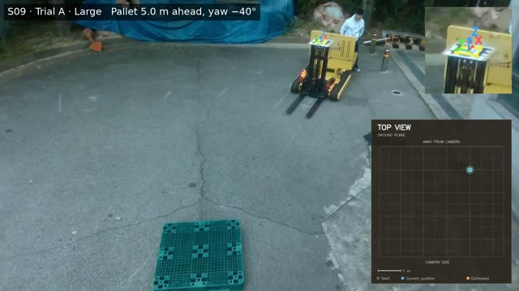
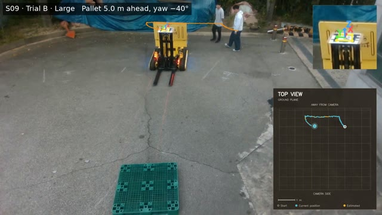
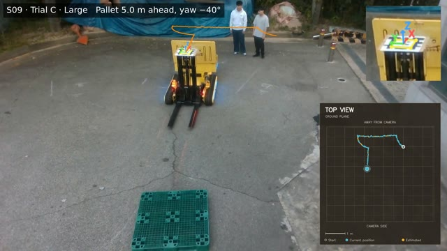

# S09 — Large initial offset

[← All scenarios](../../README.md)

## Initial configuration

| dforward (m) | ψ (°) | δ0 (m) |
|---|---|---|
| 5.0 | -40 | -4.2 |

The pallet front center is placed on the camera forward axis. dforward is the forward distance from the camera to the pallet front, ψ is the pallet yaw, the angle between the fork insertion direction and the camera forward axis (clockwise positive, viewed from above), and δ0 = dforward tan ψ is the lateral offset of the camera from the pallet insertion axis.

## Trials

All three trials completed alignment and fork insertion. Thumbnails show the first frame of each video; click one to open the video.

| Trial A | Trial B | Trial C |
|---|---|---|
|  |  |  |

Each video shows the overhead top-view recording with the tracked forklift trajectory.
